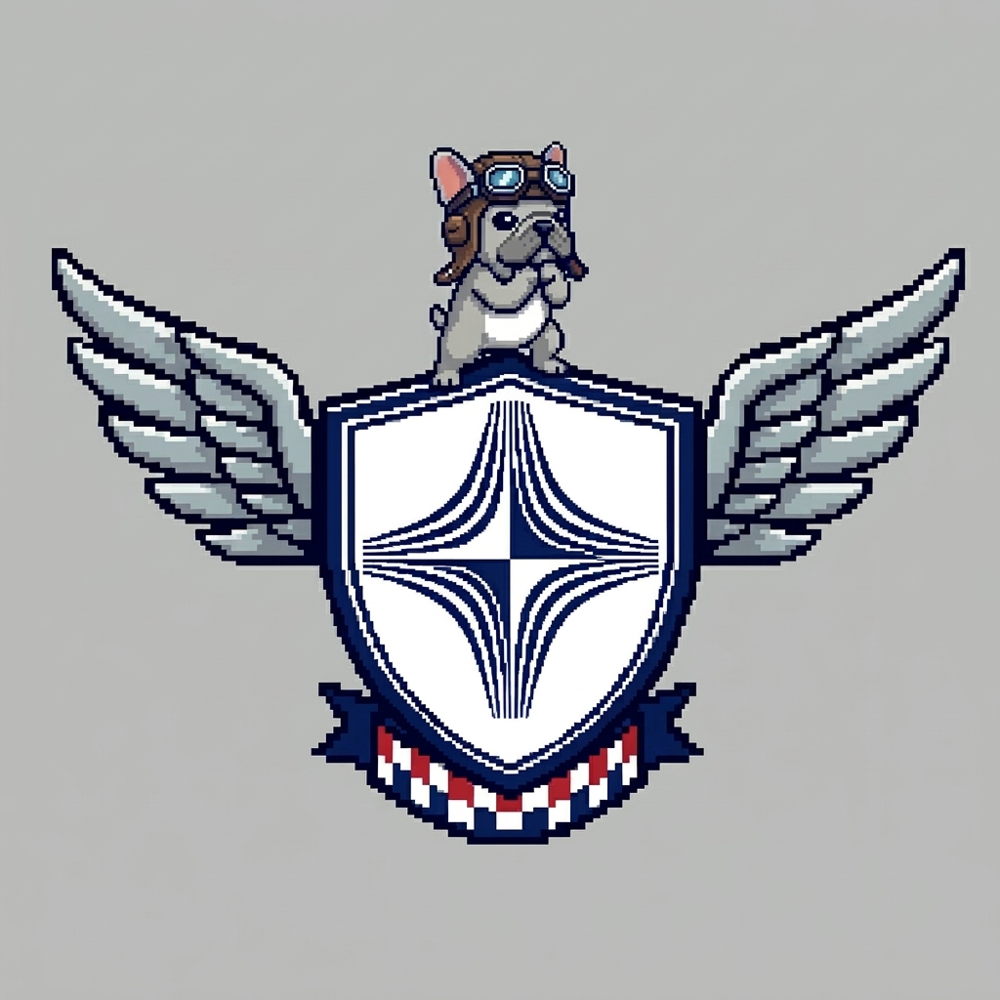
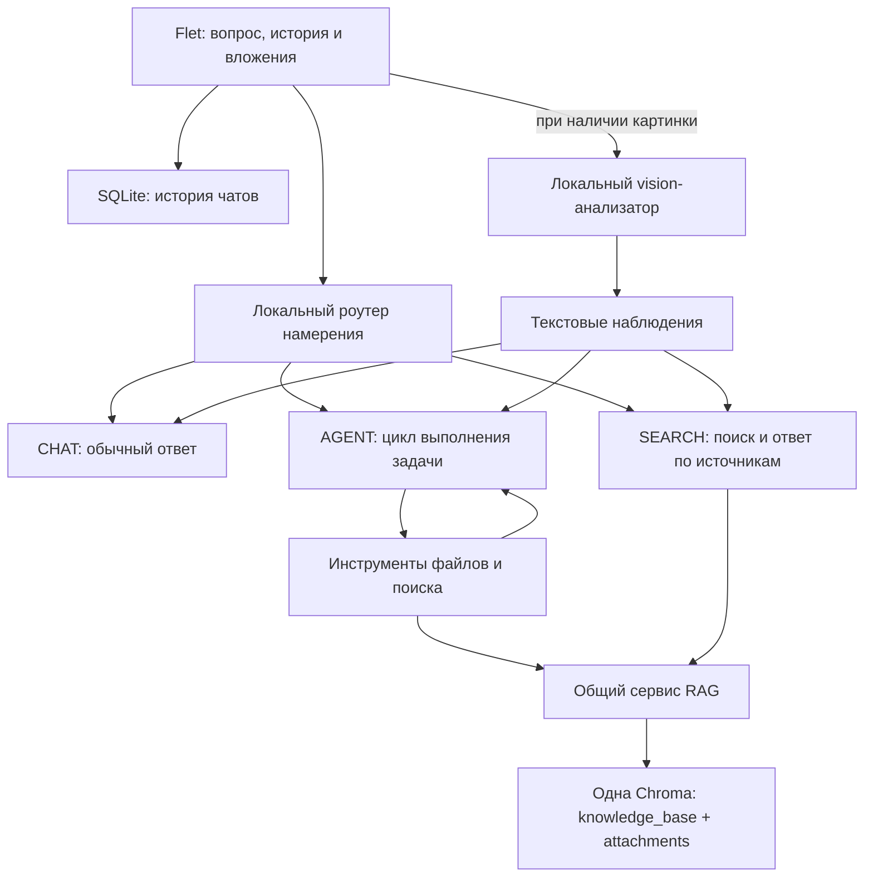

<div align="center">
  
  <h1>BUTUZ AI</h1>
  <p><strong>Локальный AI-помощник для работы с документами и файлами</strong></p>
  <p>Общайтесь с моделью, находите ответы в своей документации и поручайте агенту подготовку файлов.</p>
  <p><code>Python 3.11–3.13</code> · <code>Flet</code> · <code>Ollama</code> · <code>Chroma</code> · <code>SQLite</code></p>
</div>

<p align="center">
  <a href="#что-это-за-проект">О проекте</a> ·
  <a href="#что-можно-сделать">Возможности</a> ·
  <a href="#быстрый-старт">Запуск</a> ·
  <a href="#как-это-работает">Архитектура</a> ·
  <a href="#проверки-и-диагностика">Проверки</a>
</p>

---

## Что это за проект

**BUTUZ AI — настольное приложение, которое соединяет локальную языковую модель с вашей базой документов и инструментами работы с файлами.** Оно полезно, когда нужно разобраться в большой инструкции, найти сведения в нескольких документах или сохранить результат работы в отдельный файл.

Проект вырос из ассистента по технической авиационной документации **ПРЛ-27СМ**. Поэтому в интерфейсе пока встречаются названия *Aviation RAG* и *PRL-27*. Сейчас архитектура поддерживает и другие документы, обычный разговор с моделью и универсального агента.

Помощник представляется как **BUTUZIK.AI**. Создатель приложения — **Demashov Michail Sergeevich**. Эти сведения одинаковы в обычном чате и в режиме агента; базовая языковая модель остаётся выбранной в Ollama.

В пустом чате вас встречает пёс-пилот и три карточки с примерами: **CHAT**, **SEARCH** и **AGENT**. Карточка запускает пример; для собственного запроса используйте поле ввода. Пример AGENT создаёт `welcome.txt` после подтверждения записи.

Индикатор в заголовке показывает фактический этап: «Думаю», «Ищу в документах», «Работаю над задачей», «Изучаю изображение», «Жду подтверждения» или «Пишу ответ». Метка CHAT / SEARCH / AGENT появляется после выбора маршрута. Во время запроса рядом с отправкой доступна **остановка**; в ожидании подтверждения и после завершения индикатор не вращается. Служебные этапы не записываются в ответ или историю. Векторные иконки и маскот загружаются из локальных ресурсов приложения.

Для ответов по документам используется **RAG**: приложение находит подходящие фрагменты в локальной базе и передаёт их модели вместе с вопросом. Загружать документы для дообучения LLM не требуется. Вместе с ответом интерфейс показывает найденные источники, по которым можно проверить результат.

**Обработка запросов выполняется на вашем компьютере через Ollama.** Документы не отправляются в облачный сервис генерации. Установка зависимостей и предварительная загрузка моделей — отдельный подготовительный шаг, для которого может понадобиться интернет.

## Что можно сделать

| Задача | Пример запроса | Режим |
| --- | --- | --- |
| Обсудить вопрос с моделью | «Объясни простыми словами, что такое RAG» | **CHAT** |
| Найти ответ в документации | «Что в документации сказано о сигнале PPS?» | **SEARCH** |
| Разобраться во вложении | «Какие основные разделы есть в этом документе?» | **SEARCH** |
| Подготовить результат в файле | «Создай файл `summary.txt` с кратким резюме» | **AGENT** |
| Помочь с кодом | «Прочитай прикреплённый скрипт и сохрани исправленную версию» | **AGENT** |

Для обычного вопроса «что на картинке?» приложение автоматически анализирует изображение локальной vision-моделью, а текстовые наблюдения передаёт выбранной модели чата. Ручное переключение не требуется. Лишний поиск по базе не запускается; явная просьба обратиться к документам сохраняет SEARCH. Если анализатор недоступен, GUI сохраняет вложение для повтора и сообщает причину.

Приложение выбирает режим автоматически. Переключатель **«Режим Агента»** явно включает работу с инструментами.

Вопросы с обозначениями оборудования и сигналов из технической базы (например, `276ГГ02`, `PPS`, `МКУ`) направляются в SEARCH, даже без слов «по документации». Просьба создать или изменить файл сохраняет возможность выбрать AGENT.

SEARCH и ответы по документации в AGENT по умолчанию развёрнутые: суть, принцип
работы или последовательность, важные условия и параметры, ссылки на документы.
Флажок агента не отключает поиск по известным обозначениям оборудования. Если
нужен короткий ответ, напишите «кратко» в текущем запросе. Для документационных
ответов предусмотрен отдельный лимит `DOCUMENT_ANSWER_MAX_TOKENS=4096`.
Короткое объяснение при достаточных источниках может быть раскрыто повторно;
содержательный черновик сверяется с выдержками отдельным запросом без инструментов
записи. Эта сверка использует ту же локальную модель и не гарантирует безошибочность.
Оглавления используются для вопросов о содержании или структуре, а посторонние
вложения не должны подмешиваться в ответ по конкретному оборудованию. Объём
ограничен найденными сведениями — недостающие параметры модель не должна выдумывать.

В модель передаётся ограниченная часть недавней истории; полная история чата
остаётся в хранилище. Слишком длинное одиночное сообщение помечается как сокращённое.
Окно контекста самой модели задаётся в Ollama, отдельно от лимита длины ответа.
При больших документах его можно увеличить в настройках Ollama с учётом доступной
памяти; приложение не меняет глобальные настройки или установленную модель автоматически.

- **CHAT** отвечает без поиска по базе документов.
- **SEARCH** ищет в общей базе знаний и индексированных вложениях текущего чата.
- **AGENT** выполняет задачу по шагам: выбирает инструмент, получает его результат и решает, что делать дальше. Для поиска он использует тот же RAG, что и SEARCH.

Агент умеет читать, создавать и редактировать файлы. Его задачи не ограничены программированием. Новые файлы хранятся в отдельной папке каждого чата; изменение прикреплённого оригинала требует подтверждения.

Дополнительно доступны голосовой ввод и работа с изображениями. Для голоса нужны заранее подготовленные модели Whisper. Для картинок по умолчанию используется установленная в Ollama **`qwen2.5vl:7b`**: она работает как внутренний анализатор. Основной моделью можно оставить текстовую **`qwen2.5:14b`**. Для агента выбранная основная модель должна поддерживать **tool calling**; он получает результаты анализа изображения как текст.

> **Статус проекта:** рабочая локальная сборка с тестами, диагностикой и проверками сохранности данных. Для промышленного применения ещё нужны экспертная оценка ответов на реальных задачах, длительные нагрузочные испытания и проверки GUI на целевых ОС. Наличие источника в ответе само по себе не гарантирует правильность вывода модели.

## Оформление Word по ГОСТ

Прикрепите один **DOC или DOCX** и нажмите **«Оформить по ГОСТ»** рядом с
«Файлами чата». Пролистайте страницы и замечания, затем подтвердите сохранение.
Результат — отдельный редактируемый DOCX в «Файлах чата»: его можно показать
в папке или скопировать через «Сохранить как…». Оригинал остаётся неизменным.
Переключать модель или включать флажок агента не нужно.

Обработчик применяет **профиль ГОСТ Р 2.105-2019 / ГОСТ Р 2.104-2023**:
оформляет размеченные разделы, интервалы и обычные абзацные отступы,
сохраняет титульный лист, рамки, таблицы и рисунки, исправляет отображение
поддерживаемых старых штампов и сверяет оглавление по страницам.
У таблиц с подписями настраиваются ширина, повтор всей шапки и переносы строк;
существующие схемы вписываются пропорционально вместе с пояснениями и подписями.
Значения ячеек, объединения и содержимое изображений сохраняются.
Основной текст сохраняет полуторный интервал **1,5**, лишние абзацные промежутки
убираются. Для простых таблиц после расчёта страниц создаются части с подписью
«Продолжение таблицы N» и повторной шапкой. Под текст резервируется место над
штампом; готовый бланк регистрации изменений сохраняет свои поля.
Для поддерживаемых старых схем с недоступным шрифтом GOST добавляется копия
с исправленным отображением букв; исходное изображение остаётся в документе.
О замене шрифта сообщается перед сохранением.
Перед записью показываются страницы, фактический текст и список проверок.

Правила и выбранные размеры вынесены в отдельный профиль. Он читает только
указанные источники, поэтому библиотеку не требуется целиком передавать модели.
Автоматическая оцифровка новых ГОСТов и выбор правил из сотен PDF — следующий этап;
простое добавление PDF пока не подключает его требования к оформлению.

**Это проект для проверки, а не подтверждение полного соответствия всему ГОСТу.**
Размеры исходных рамок, реквизиты и специальные элементы требуют отдельной оценки.
PDF, сканы и создание форм с нуля пока не поддерживаются этим действием.
Лимиты: 32 МБ на исходник, до 60 страниц предпросмотра.

При установленном Docker отдельно подготовьте обработчик из корня проекта:

```bash
# Разовая сборка может обращаться к интернету:
docker build -t butuz-documents:local -f document_runtime/Dockerfile .
```

Во время обработки используется только готовый локальный образ, без сети и
автоматических загрузок. В него передаётся копия одного выбранного файла;
DOCX и страницы возвращаются через проверяемый экспорт. Python-песочница
`butuz-sandbox:local` остаётся отдельной. После обновления кода обработки образ
документов нужно пересобрать — устаревший код не принимается.

Подробности: [профиль оформления и ограничения](docs/gost-formatting.md).

## Быстрый старт

### 1. Подготовьте окружение

Понадобятся:

- **Python 3.11–3.13** и **uv** для установки зависимостей;
- **Ollama** с установленной локальной моделью;
- локальный кэш эмбеддера `intfloat/multilingual-e5-small` для поиска по документам;
- ваши документы — в репозиторий пользовательская база не включена.

По умолчанию используется `qwen2.5:14b`. Требования к памяти зависят от выбранной модели и её квантования. Можно указать другой установленный тег модели.

<details>
<summary><strong>Если модели ещё не подготовлены</strong></summary>

Это явный подготовительный шаг с возможным доступом к интернету. Само приложение модели не скачивает.

Установите [Ollama](https://ollama.com/) и [uv](https://docs.astral.sh/uv/getting-started/installation/). Затем загрузите LLM:

```bash
ollama pull qwen2.5:14b
# Дополнительно, для автоматического анализа изображений:
ollama pull qwen2.5vl:7b
```

После установки Python-зависимостей из шага 2 подготовьте эмбеддер:

```bash
uv run python -c "from huggingface_hub import snapshot_download; snapshot_download('intfloat/multilingual-e5-small')"
```

Необязательный реранкер улучшает переоценку результатов поиска. Без него приложение использует поиск без этого этапа:

```bash
uv run python -c "from huggingface_hub import snapshot_download; snapshot_download('BAAI/bge-reranker-v2-m3')"
```

Для голосового ввода отдельно подготовьте кэш моделей `faster-whisper` **base** и **small**. На полностью изолированном компьютере модели и зависимости нужно перенести заранее.

</details>

### 2. Установите проект

Команды ниже относятся к ветке `codex/production-hardening`, в которой находится описанная версия приложения. Примеры команд даны для macOS/Linux.

```bash
git clone --branch codex/production-hardening https://github.com/devfounder1/prod-aviation-rag-system.git
cd prod-aviation-rag-system

uv sync --locked
cp .env.example .env
```

В `.env` укажите модель и устройство для эмбеддингов:

```dotenv
LLM_MODEL_NAME=qwen2.5:14b
VISION_MODEL_NAME=qwen2.5vl:7b
LLM_BASE_URL=http://127.0.0.1:11434/v1
EMBEDDER_DEVICE=mps
```

На компьютере без доступного Apple MPS замените `mps` на **`cpu`**. Полный набор параметров приведён в [`.env.example`](.env.example).

### 3. Проверьте Ollama и запустите приложение

Если сервис Ollama ещё не работает, запустите его в отдельном терминале:

```bash
ollama serve
```

Из папки проекта:

```bash
ollama list
uv run python doctor.py
uv run python prilozhenie.py
```

`doctor.py` проверяет окружение, выбранную модель, кэш моделей и локальные базы. Он не скачивает модели и не запускает генерацию. Сообщение о том, что хранилище ещё не создано, допустимо перед первым использованием.

### 4. Добавьте документы и задайте вопрос

1. Укажите локальную папку документов при первоначальной настройке.
2. В **«Настройки → База знаний PRL-27»** выберите папку и нажмите **«Перестроить индекс PRL-27»**. Дождитесь завершения индексации.
3. Задайте вопрос о содержимом документов и проверьте источники под ответом.
4. Для разового анализа используйте кнопку прикрепления файла в чате. Для создания файла включите режим агента и опишите желаемый результат.

Парсер пользовательских документов поддерживает **PDF, DOCX, TXT, Markdown, CSV и XLSX**. Состав поддержки различается между загрузкой вложений и основной индексацией. PDF должен содержать извлекаемый текст: распознавание сканов через OCR не входит в текущий пайплайн.

<details>
<summary><strong>Другие точки входа</strong></summary>

Разговор через терминал:

```bash
uv run python main.py
```

Импорт поддерживаемых файлов из папки как общих пользовательских документов:

```bash
uv run python ingest_folder.py ./knowledge_base
```

Такие документы получают `chat_id=global` и доступны всем чатам. Для CLI нет GUI-подтверждения, поэтому изменение прикреплённого оригинала через защищённый инструмент недоступно.

Перенос старых индексов без загрузки LLM и эмбеддера:

```bash
uv run python storage.py
```

Перед первым переносом остановите прежний экземпляр приложения.

</details>

## Как это работает



Для маршрутизации, итоговых ответов и выбора инструментов используется **выбранная LLM в Ollama**. Изображения предварительно обрабатываются локальным анализатором `VISION_MODEL_NAME`, а эмбеддер и реранкер обслуживают поиск. Основная модель в GUI остаётся выбранной. Если она уже совпадает с vision-моделью, картинку можно обработать напрямую, без повторного анализа.

Анализатор выделяет видимые объекты, подписи и неопределённости. Его вывод — вспомогательные данные, а не гарантированная расшифровка: возможны пропуски и ошибки деталей. Два последовательных прохода и загрузка моделей могут увеличивать задержку. `VISION_MAX_TOKENS` ограничивает размер описания (по умолчанию 512).

Поиск объединяет **BM25** для совпадений терминов и **векторный поиск** для близких по смыслу фрагментов. Результаты объединяются через **RRF**, затем при наличии локальной модели переоцениваются реранкером. В основной базе используется parent-child retrieval: поиск по небольшим фрагментам помогает вернуть более полный контекст из родительского документа.

Тяжёлая работа выполняется вне GUI event loop. Для Python-интеграций доступны синхронный `SmartRAG.query_stream(...)` и асинхронный `await rag.aquery(...)`.

## Где находятся данные

| Путь | Назначение |
| --- | --- |
| `data/chroma/` | Одна локальная Chroma с коллекциями `knowledge_base` и `attachments` |
| `data/chroma/parent_docs/` | Родительские фрагменты основной базы |
| `data/chats.sqlite3` | История чатов с транзакциями SQLite |
| `agent_workspace/chats/<hash>/` | Отдельная рабочая папка агента для каждого чата |
| `data/backups/` | Резервные копии истории и индексов |
| `data/legacy_snapshots/` | Копии старых баз для миграции |
| `logs/` | Локальные журналы с ротацией |
| `eval-results/` | Локальные результаты benchmark |

Вложения фильтруются по `chat_id`; документы с меткой `global` явно доступны всем чатам. Рабочие папки, базы, пользовательские документы, история, журналы и локальные настройки исключены из Git. Это правило относится к текущему составу ветки: данные, ранее закоммиченные в старые версии, остаются в истории репозитория.

### Как получить созданный файл

Нажмите **«Файлы чата»** над полем ввода. В списке доступны результаты текущего чата, включая файлы, созданные раньше. Копии вложений и служебные файлы скрыты.

Если вы попросили сохранить код, одного блока кода в ответе недостаточно: агент
должен вызвать запись и показать окно подтверждения. Для нескольких файлов
подтверждается каждый файл. Итог перечисляет фактически записанные и проверенные
файлы; если модель осталась на обещании, приложение повторно направляет её к
инструменту и сообщает о несохранённом результате при неудаче.

При редактировании вложения результат сохраняется в видимой папке `results/` внутри рабочей папки чата: например, `attached/script.py` → `results/script.py`. Входная копия и исходник остаются прежними. Для изменения оригинала нужен отдельный инструмент с явным подтверждением.

Перед подтверждением Python-файлы проходят проверку синтаксиса. Ошибочные буквальные `\n` между командами исправляются только в однозначных случаях; строковые литералы, регулярные выражения и пути сохраняют своё экранирование. Неисправленный или неоднозначный код не записывается. После записи приложение перечитывает файл и формирует итог по проверенному результату. **Проверка синтаксиса не запускает код или тесты и не гарантирует правильность поведения программы.**

### Работа с папкой проекта

Нажмите **«Открыть проект»** над полем ввода и выберите папку исходного кода.
Откроется встроенное окно: можно переходить по папкам или вставить полный путь,
затем нажать **«Импортировать проект»**. Системный диалог Flet для этого не нужен.
Приложение копирует её в текущий чат с сохранением вложенных каталогов, показывает
количество файлов и включает режим агента. Импорт остаётся доступен после
перезапуска приложения; проекты других чатов недоступны. Чтобы обновить исходные
данные, выберите папку ещё раз: создаётся отдельный снимок, прежний сохраняется.

Например: «Найди причину падения тестов в этом проекте, исправь её и проверь
повторно». Агент получает список проектов, может посмотреть карту файлов,
Python-функций, классов и импортов, найти текст по всему проекту и прочитать
нужные строки. Для других языков доступны пути файлов и текстовый поиск;
AST-карта символов и запуск тестов сейчас поддерживают Python.

При правке показываются **различия и полное будущее содержимое файла**. Первая
подтверждённая запись создаёт полную рабочую копию под `results/projects/`,
сохраняя остальные импортированные файлы без изменений. Следующие чтения и
правки используют эту копию, даже если модель указывает старый входной путь.
Результат доступен через **«Файлы чата» → «Открыть папку»**; большие списки
разбиты по 50 файлов. Выбранная исходная папка не меняется, автоматической
обратной синхронизации нет. Каждая новая правка подтверждается отдельно.

Импорт принимает до **1500 текстовых файлов, 16 МБ суммарно и 1 МБ на файл**.
Зависимости, сборки и кеши (`node_modules`, `vendor`, `venv`, `dist`, `build`,
`__pycache__` и другие известные каталоги), скрытые/служебные папки, `.env`,
типовые файлы секретов, lock-файлы, бинарные файлы и символические ссылки
исключаются. Используется фиксированный фильтр расширений и имён, а не все
правила `.gitignore`; произвольно названные секреты фильтр распознать не может.
Отчёт показывает число пропущенных элементов (каталог считается одним элементом).
Если общий лимит превышен или импорт отменён, неполный проект не публикуется.

Агент не загружает весь проект в модель. Вывод инструментов ограничен, а старые
результаты чтения убираются целыми обменами с короткими заметками о выполненных
шагах. Исходная задача и сохранённая история не переписываются; сокращённый
вывод явно помечается. `AGENT_CONTEXT_CHARS=16000` задаёт приблизительный бюджет
символов сообщений, без схем инструментов; это **не** размер токенового окна
Ollama. При невозможности вместить задачу агент просит сузить её вместо скрытого
обрезания исходного запроса. Лимит работы — `AGENT_MAX_STEPS=30` шагов.

Для Python агент может запускать файл или каталог тестов через `run_pytest` в
подготовленном локальном Docker. В контейнер передаётся только текущая копия
выбранного проекта, рабочим каталогом становится его корень. Сохраняются
ограничения из раздела выполнения кода: без сети и установки зависимостей,
30 секунд на запуск. Если тесты требуют отсутствующих библиотек, это будет
ошибкой запуска, а не успешной проверкой. На основании вывода тестов агент может
предложить следующую правку; автоматический успех любой задачи не гарантируется.

- **«Показать в папке»** рядом с файлом выделяет его в Finder на macOS; **«Открыть папку»** открывает рабочую папку чата.
- **«Сохранить как…»** открывает системное окно выбора имени и места. Можно сохранить копию в «Документы» или на рабочий стол; исходный результат остаётся в чате. Экспорт во внутренние папки приложения запрещён.

Рабочие папки остаются раздельными: вручную искать каталог с хешем или переносить существующие файлы не требуется.

## Границы работы агента

- Инструменты доступны в рабочей папке **конкретного чата**. Переходы за её пределы, в том числе через symlink, отклоняются.
- В GUI создание, перезапись и дополнение файла требуют подтверждения кнопкой **«Разрешить запись»**. Окно показывает действие, полный путь и будущее содержимое. Писать «да» в чат не нужно. Каждая отдельная запись подтверждается отдельно; отказ не открывает повторное окно для того же файла в рамках текущего запроса.
- **«Отмена»**, закрытие окна, смена чата, отмена задачи или две минуты без ответа запрещают ожидающую запись. Если файл изменился во время ожидания, запись тоже отклоняется. В CLI без GUI-подтверждения записи внутри рабочей папки выполняются сразу; изменение прикреплённого оригинала остаётся недоступным.
- Для изменения оригинала файл должен быть прикреплён к **текущему запросу**. Пользователь подтверждает путь и новое содержимое; перед записью создаётся резервная копия.
- Если оригинал изменился после прикрепления или задача отменена до записи, изменение отклоняется.
- Агент не получает инструменты выполнения произвольного **Python или shell** на компьютере. Поддержка программирования включает чтение и редактирование кода.
- При переключении, создании или подтверждённом удалении чата запрос отменяется; открытие диалога удаления само по себе не останавливает ответ. Запоздалые callbacks не должны менять интерфейс новой задачи.

Нативный расчёт эмбеддингов завершает текущий вызов перед остановкой задачи. Уже начатую атомарную запись файла отмена не откатывает. Эти ограничения реализованы в приложении и не заменяют песочницу операционной системы.

Кнопка остановки прерывает ожидание локальной Ollama, включая время до первого ответа сервера; отменённый запрос не перезапускается автоматически. Закрытие окна отменяет активные задачи и останавливает голосовой слушатель. Для обычной работы используйте `uv run python prilozhenie.py`; команда `uv run flet run prilozhenie.py` предназначена для разработки с автоматической перезагрузкой при изменении исходников.

Все LLM-запросы направляются на `http://127.0.0.1:11434/v1`. Для них отключены прокси из окружения и HTTP-перенаправления; облачная трассировка также отключена.

## Проверки и диагностика

```bash
# Проверка локального окружения и хранилищ
uv run python doctor.py

# Автоматические тесты, без Ollama и пользовательской базы
uv run pytest -q

# Строгая проверка типов новых модулей
uv run mypy --strict --follow-imports=silent chat_store.py routing.py jobs.py file_tools.py doctor.py logging_config.py

# Детерминированная проверка поиска на вымышленном корпусе
uv run python evaluate_rag.py

# Оценка с реальными локальными LLM, эмбеддером и реранкером
uv run python evaluate_rag.py --live
```

Benchmark проверяет найденный источник, эталонный факт, имя документа в цитировании и отказ при недостатке данных. Он использует **пять вымышленных сценариев**, не затрагивая пользовательскую базу. Детерминированный прогон проверяет работу поиска; только `--live` оценивает ответы локальной модели.

Проверки выполнены на macOS/Python 3.13, включая установку в отдельное чистое окружение. [CI](.github/workflows/checks.yml) настроен для Linux: тесты, типы новых модулей и синтаксис GUI-интеграции. Другие платформы требуют отдельной проверки интерфейса. Во всём прежнем коде ещё остаются ошибки типизации.

Подробные результаты, границы проверок и оставшиеся задачи — в [PRODUCTION_PROGRESS.md](PRODUCTION_PROGRESS.md).

## Если что-то не работает

| Симптом | Что проверить |
| --- | --- |
| Нет соединения с моделью | Работает ли `ollama serve`; доступен ли порт `11434` |
| Модель не найдена | Совпадает ли `LLM_MODEL_NAME` с тегом из `ollama list` |
| Поиск не запускается | Есть ли эмбеддер в локальном кэше; запустите `doctor.py` |
| Ошибка устройства MPS | Установите `EMBEDDER_DEVICE=cpu` и перезапустите приложение |
| Ответа нет в документах | Проверьте индексацию, извлекаемый текст и область доступа вложения |
| Агент не вызывает инструменты | Поддерживает ли выбранная модель tool calling; включён ли режим агента |
| Не удаётся изменить оригинал | Прикреплён ли файл к текущему запросу и доступно ли подтверждение в GUI |
| Изображение не распознаётся | Проверьте, что `VISION_MODEL_NAME` указывает на установленную vision-модель; по умолчанию `qwen2.5vl:7b`. Переключать модель чата не нужно |

## Обновление и восстановление

<details>
<summary><strong>Перенос со старой версии: документы и история</strong></summary>

Остановите старое приложение перед первым переносом.

- Старые `chroma_db_prl27/` и `user_docs_chroma/` копируются в `data/legacy_snapshots/`. Миграция читает копии, сохраняя ID, тексты, метаданные, исходные векторы и `parent_docs`. Каждая партия проверяется; маркер успеха записывается в конце. Оригиналы не удаляются.
- `chats_history.json` импортируется в SQLite одной транзакцией, с побайтовой резервной копией JSON и проверкой совпадения данных. Исходный файл не перезаписывается. Повреждённая история вызывает ошибку, а не подменяется пустой.
- После успешного переноса исходные JSON и базы повторно не импортируются. Старую и новую версии нельзя использовать параллельно: их изменения не синхронизируются.
- Исторические эмбеддинги сохраняют прежний способ кодирования. При смене модели или схемы эмбеддингов нужна отдельная переиндексация.
- Пересборка основной базы создаёт резервную копию, записывает новые фрагменты и только после успешной записи удаляет старые векторы этой коллекции. Вложения сохраняются. Не запускайте пересборку одновременно с запросами.

</details>

<details>
<summary><strong>Резервные копии и восстановление</strong></summary>

История использует SQLite WAL и `synchronous=FULL`. Для согласованной копии работающей базы используйте `ChatStore.backup(Path(...))`: метод учитывает WAL, проверяет целостность и не перезаписывает существующий файл. Копирование только основного SQLite-файла во время работы может пропустить последние изменения.

Перед обновлением сохраните snapshot истории, оригиналы документов и всю папку `data/chroma/` вместе с `parent_docs`. **Chroma копируйте при остановленном приложении.** Для восстановления используйте отдельную чистую папку, проверьте SQLite через `PRAGMA integrity_check`, восстановите Chroma целиком и только затем запускайте приложение. Не смешивайте WAL/SHM-файлы разных snapshots.

Журналы ограничены ротацией: основной файл до 2 МБ и три архивных файла. Резервные копии и пользовательские документы требуют отдельного контроля свободного места.

</details>

## Основные модули

| Модуль | Ответственность |
| --- | --- |
| [`prilozhenie.py`](prilozhenie.py) | Настольный интерфейс Flet |
| [`smart_rag.py`](smart_rag.py) | Обработка запроса и общий сервис поиска |
| [`routing.py`](routing.py) | Выбор CHAT / SEARCH / AGENT |
| [`llm_client.py`](llm_client.py) | Подключение к локальной Ollama |
| [`ai_agent.py`](ai_agent.py) · [`file_tools.py`](file_tools.py) | Цикл агента и инструменты файлов |
| [`jobs.py`](jobs.py) | Отмена задач и защита от запоздалых callbacks |
| [`hybrid_retriever.py`](hybrid_retriever.py) · [`vector_store.py`](vector_store.py) | Гибридный поиск и parent-child retrieval |
| [`document_processor.py`](document_processor.py) | Обработка пользовательских документов |
| [`storage.py`](storage.py) · [`chat_store.py`](chat_store.py) | Хранилища и перенос прежних данных |
| [`doctor.py`](doctor.py) · [`evaluate_rag.py`](evaluate_rag.py) | Диагностика и оценка RAG |

Правила разработки и работы с данными описаны в [AGENTS.md](AGENTS.md).

## Локальная песочница для запуска кода и тестов

Агент умеет запускать Python-файлы и pytest через инструменты `run_python` и `run_pytest`. Например: «Запусти results/script.py и покажи вывод» или «Запусти pytest для results/test_script.py». В ответе показываются stdout, stderr, код завершения и время, включая ошибки, тайм-ауты и отмену. Выполнение Python на хосте не предоставляется.

Нужен запущенный локальный Docker (на macOS — Docker Desktop). Однократно подготовьте образ из корня проекта:

```bash
docker build -t butuz-sandbox:local sandbox
```

Этот шаг загружает базовый образ и устанавливает NumPy/pytest. Во время запуска агент использует только готовый локальный образ с `--pull=never`; при отсутствии движка или образа сообщает причину. Дополнительные зависимости добавляются в Dockerfile и устанавливаются при отдельной пересборке, а не по команде пользовательского кода.

Каждое выполнение получает фильтрованную копию файлов текущего чата, без symlink, скрытых файлов и каталогов. Ограничения: сеть отключена, пользователь без root, корневая ФС и входная копия доступны только для чтения; 1 CPU, 512 МБ памяти, 64 процесса, временные /work 64 МБ и /tmp 32 МБ, максимум 30 секунд и 64 КБ общего вывода. Созданные внутри файлы удаляются вместе с контейнером; для постоянного результата используются обычные файловые инструменты с подтверждением.

Проверка настоящей песочницы (Docker и подготовленный образ обязательны):

```bash
BUTUZ_SANDBOX_LIVE=1 uv run pytest -q tests/test_sandbox_runner.py
```
